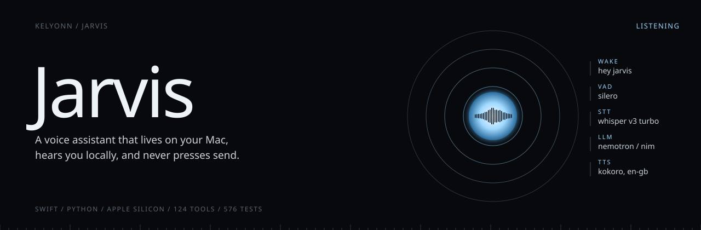
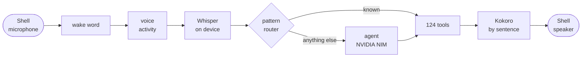

<p align="center">
  
</p>

<p align="center">
  <b>Say "Hey Jarvis". It does the thing. It never presses send.</b><br>
  <sub>A voice assistant that runs all day on your own Mac. Ears and voice stay on the machine; only the thinking goes out.</sub>
</p>

<p align="center">
  <sub>
    <a href="#overview">OVERVIEW</a> &nbsp;·&nbsp;
    <a href="#quick-start">QUICK START</a> &nbsp;·&nbsp;
    <a href="#how-it-works">HOW IT WORKS</a> &nbsp;·&nbsp;
    <a href="#what-you-can-ask">WHAT YOU CAN ASK</a> &nbsp;·&nbsp;
    <a href="#safety">SAFETY</a> &nbsp;·&nbsp;
    <a href="#status">STATUS</a>
  </sub>
</p>

<br>

<table>
  <tr>
    <td><sub>PLATFORM</sub><br><b>macOS 14+, Apple Silicon</b></td>
    <td><sub>PROCESSES</sub><br><b>Swift shell + Python daemon</b></td>
    <td><sub>TOOLS</sub><br><b>124</b></td>
    <td><sub>TESTS</sub><br><b>576 Python · 19 Swift</b></td>
    <td><sub>SENDS MESSAGES</sub><br><b>Never</b></td>
  </tr>
</table>

## Overview

Jarvis lives in your menu bar and listens for its name. Ask it to open and arrange your apps, play a playlist, set a timer, read your messages, or brief you on your day, and it does.

Speech recognition, the wake word, your voiceprint and the voice itself all run locally. Only the language model is remote, through NVIDIA NIM.

> [!IMPORTANT]
> Jarvis never sends a message on your behalf. It drafts the reply, places it in the compose box, and waits for you.

## Quick start

You need macOS 14+ on Apple Silicon, Xcode command line tools, Homebrew, Python 3.12, about 4 GB of disk, and a free NIM key from [build.nvidia.com](https://build.nvidia.com).

```bash
./scripts/install.sh      # venv, speech models, Homebrew tools, builds Jarvis.app
jarvisd set-key           # NIM key into the Keychain
jarvisd setup             # name, permissions, routines, VIPs, briefing times
jarvisd doctor            # should end with 0 broken
open ~/Applications/Jarvis.app
```

On first launch it asks for microphone, accessibility, screen recording and Full Disk Access. The last one is how it reads iMessage, WhatsApp and Focus state.

> [!TIP]
> Say **"Hey Jarvis, learn my voice"** and read back six phrases. From then on it only acts on you.

## How it works

Jarvis is two processes talking over a local WebSocket. The Swift half owns everything that needs a signed Mac app; the Python half owns the brain.



- **The router comes first.** Common commands ("pause the music", "ten-minute timer") are matched by pattern and answered with no model call at all.
- **Everything else goes to an agent** that decides how hard to think, calls tools, and asks out loud before anything risky.
- **Speech streams by sentence,** so you hear the first sentence while the third is still being written.

| Layer | Runs | What |
|---|---|---|
| Wake word | on the Mac | openWakeWord, "Hey Jarvis" |
| Voice activity | on the Mac | Silero VAD |
| Speech to text | on the Mac | mlx-whisper, `whisper-large-v3-turbo` |
| Speaker check | on the Mac | a local voiceprint |
| Language model | remote | NVIDIA NIM, Nemotron by default, with fallbacks |
| Text to speech | on the Mac | Kokoro, British male voice |

## What you can ask

Talk however suits the moment: "Hey Jarvis", <kbd>Option</kbd>+<kbd>Space</kbd> to speak, or <kbd>Option</kbd>+<kbd>Shift</kbd>+<kbd>Space</kbd> to type. Interrupt it mid-sentence. After an answer it keeps listening for a few seconds, so follow-ups need no wake word.

<table>
  <tr>
    <td width="50%" valign="top">
      <b>Run the Mac</b><br>
      <sub>Open, quit and arrange apps. Snap and resize windows. Volume, brightness, dark mode, sleep, Wi-Fi, Bluetooth, AirPods. Focus, Night Shift and Stage Manager through Shortcuts it builds for you. Files, browser tabs, and shell commands behind an allow-list.</sub>
    </td>
    <td width="50%" valign="top">
      <b>Keep time</b><br>
      <sub>Timers and alarms that survive sleep and restarts. Anything 90 seconds or longer also becomes a Reminders alarm, so it rings on your phone. Reminders, notes, Calendar and Google Calendar.</sub>
    </td>
  </tr>
  <tr>
    <td valign="top">
      <b>Brief you</b><br>
      <sub>A spoken morning brief on first unlock: calendar, weather, your markets, news, unread messages. Ask "brief me" any time for only what changed.</sub>
    </td>
    <td valign="top">
      <b>Interrupt you, carefully</b><br>
      <sub>Meetings, VIP messages, market moves, rain, low battery. Held while you are on a call, sharing your screen or in Focus, then read back when you ask "what did I miss".</sub>
    </td>
  </tr>
  <tr>
    <td valign="top">
      <b>Read and draft</b><br>
      <sub>WhatsApp, iMessage, Gmail and LinkedIn. Replies drafted in your own style, learned from what you have sent before.</sub>
    </td>
    <td valign="top">
      <b>Remember</b><br>
      <sub>Facts you tell it ("my brother is Arjun") and what it learns about people. List everything it knows, or make it forget.</sub>
    </td>
  </tr>
  <tr>
    <td valign="top">
      <b>See the screen</b><br>
      <sub>Describe what is in front of you or explain an error. A narrated computer-use mode stops the instant you touch the mouse or say "stop".</sub>
    </td>
    <td valign="top">
      <b>Think when it should</b><br>
      <sub>Web search, exact arithmetic, and a private first pass of reasoning for comparisons, plans and debugging.</sub>
    </td>
  </tr>
</table>

<details>
<summary><b>Every command-line command</b></summary>
<br>

| Command | What it does |
|---|---|
| `jarvisd text` | Same brain, in the terminal |
| `jarvisd say "..."` | Speak text in Jarvis's voice |
| `jarvisd brief [--full\|--delta]` | Run a briefing now |
| `jarvisd doctor [--fix]` | Permissions, models, connectivity |
| `jarvisd logs [--audit] [-f]` | Daemon or audit log |
| `jarvisd shortcuts list\|install` | The Shortcuts Jarvis builds |
| `jarvisd vip add "Mom"` | VIP contacts |
| `jarvisd memory` · `jarvisd forget --person Rahul` | What it remembers |
| `jarvisd routines list` | Apps, layout and Focus in one command |
| `jarvisd config edit` | `~/.jarvis/config.toml`, hot-reloaded |
| `jarvisd voice-id enroll\|forget\|status` | Voice recognition |
| `jarvisd run --standalone` | Voice loop without the Shell |

</details>

## Safety

A voice assistant with tools is a program anyone near your Mac can talk to. The rules follow from that.

- **Nothing is ever sent.** There is no send action for any messaging app.
- **Risky actions need a spoken yes:** deleting, power, emptying the Trash, unlisted shell commands, computer use.
- **Content is data, not instructions.** A file telling Jarvis to run commands gets summarised, and nothing runs.
- **Every tool call is audited** in `~/.jarvis/audit.log`. Message and clipboard content is stored only as a hash.
- **Secrets live in the Keychain.** Data lives in `~/.jarvis/`, readable only by you.

<details>
<summary><b>Limits worth knowing before you install</b></summary>
<br>

| It cannot | Because |
|---|---|
| Understand requests offline | Speech is local; reasoning needs NIM. Offline it still speaks timers and a template brief. |
| Run on Intel or other platforms | The local speech stack needs Apple Silicon. |
| Set Clock app timers | macOS blocks it, so Jarvis keeps its own. |
| Toggle Low Power Mode | Shortcuts cannot on a Mac. |
| Wake on a phrase you choose | The wake model only knows "Hey Jarvis". |
| Idle cheaply, yet | About 10% of one core and 3.3 GB while idle. |

</details>

## Status

| Area | Status |
|---|---|
| Voice loop, Shell, brain, Mac control, Shortcuts, timers, setup | **Verified** on a real Mac |
| Briefings, alerts, messaging, memory | **Tested**, limited live use |
| Screen description, computer use | **Built**, not yet checked end to end |

The full ledger is in [`docs/STATUS.md`](docs/STATUS.md).

**Next:** idle under 3% CPU, a local MLX model for fully offline use, a trainable wake word, and a phone companion.

<details>
<summary><b>Development and layout</b></summary>
<br>

```bash
uv venv --python 3.12 .venv && VIRTUAL_ENV=.venv uv pip install -e ".[dev,voice]"
.venv/bin/python -m pytest          # 576 tests
cd JarvisShell && swift test        # 19 tests
./scripts/build_shell.sh
```

```
JarvisShell/        Swift menu-bar app: audio, orb, hotkeys, IPC, accessibility
jarvis_core/
  router.py         fast pattern routing, intents.yaml
  brain/            agent loop, reasoning modes, persona
  skills/           the 124 tools
  voice/            wake word, VAD, STT, TTS, speaker ID
  briefing/ alerts/ comms/ memory/ vision/ policy/ ipc/
```

</details>

<br>

<sub>The Calendar and Contacts readers follow the schema handling in the open-source <a href="https://github.com/open-jarvis/OpenJarvis">OpenJarvis</a> connectors (Apache-2.0). Jarvis does not import or install OpenJarvis.</sub>

## More features

Newer features (Space to interrupt, rich cards, offline fallback, MCP, memory) are described in [docs/FEATURES.md](docs/FEATURES.md).
